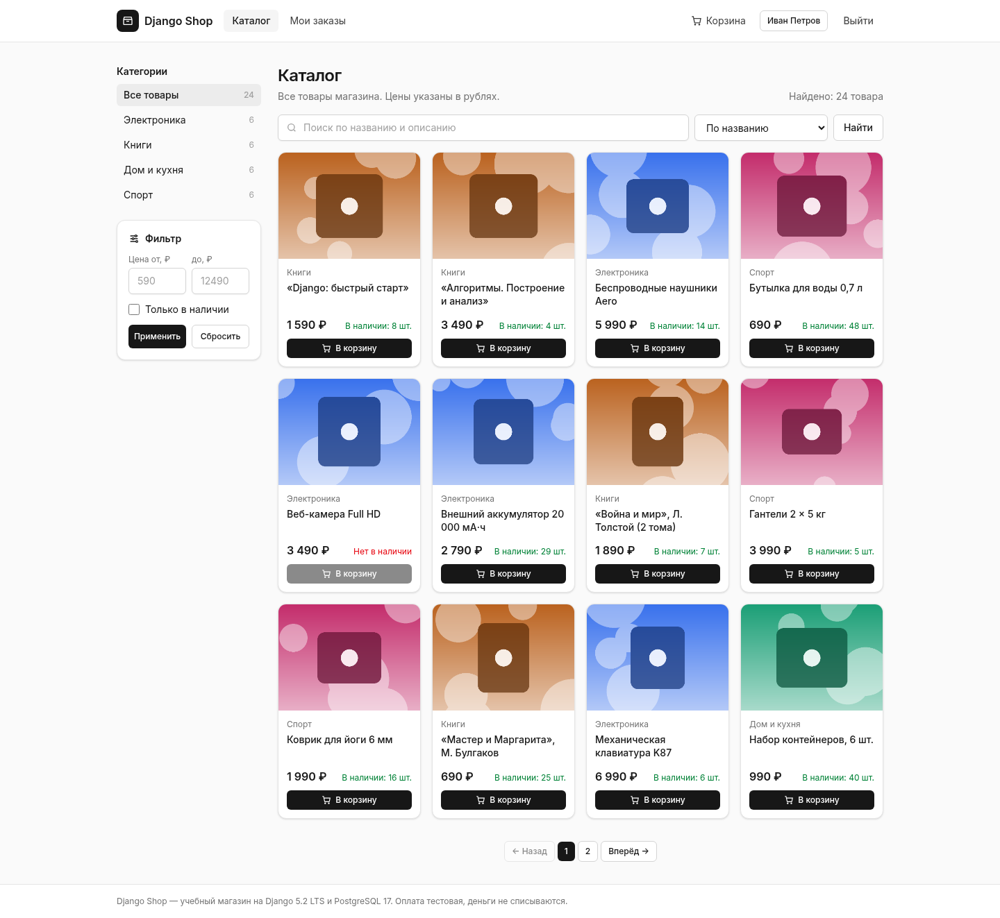
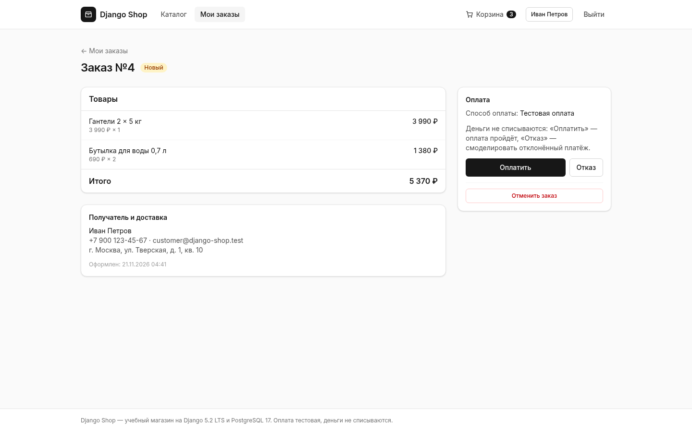
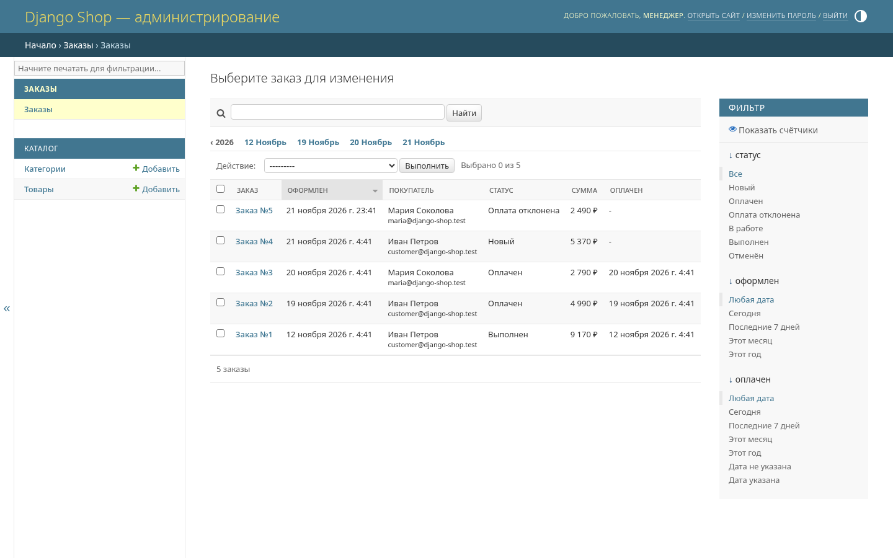

# Django Shop

Учебный интернет-магазин на **Django 5.2 LTS** — тот же функционал v2, что у [laravel-shop](https://github.com/dsefremov/laravel-shop),
[symphony-shop](https://github.com/dsefremov/symphony-shop), [bitrix-shop](https://github.com/dsefremov/bitrix-shop)
и [bitrix-shop-classic](https://github.com/dsefremov/bitrix-shop-classic), сделанный «по-джанговски»: серверные шаблоны
и формы, class-based views, `django.contrib.auth`, `django.contrib.admin`, `django-filter`. База — **PostgreSQL 17**.
Цены в рублях, интерфейс на русском. Те же демо-данные, тот же e2e-сценарий и те же экраны 01–13.

## Что умеет

- **Каталог** — категории, поиск по названию и описанию, фильтры цены и наличия, сортировка (название, цена,
  новизна), 12 товаров на страницу, карточка товара. Фильтры — `django_filters.FilterSet` с `OrderingFilter`
  (`?q=…&price_min=…&price_max=…&in_stock=1&ordering=-price`); неверные параметры молча отбрасываются,
  в поиске `%` и `_` ищутся буквально (`icontains`).
- **Корзина** — у гостя в сессии, у вошедшего — в таблице `cart_cartitem` (переживает выход и другие устройства).
  При входе (сигнал `user_logged_in`) корзина гостя сливается с корзиной покупателя. Количество всегда
  ограничено остатком.
- **Оформление** — только для вошедших (`LoginRequiredMixin`, после входа — обратно на `/checkout/`).
  Одна транзакция: `select_for_update()` строк товаров в порядке id, проверка и резерв остатка (`F('stock') - n`),
  снимок названия и цены в позициях. Два покупателя не купят последний товар одновременно (есть тест на гонку).
- **Оплата** — шлюз-заглушка `orders.payments.FakePaymentGateway` (подменяется настройкой `PAYMENT_GATEWAY`).
  «Оплатить» → «Оплачен»; «Отказ» → «Оплата отклонена», резерв сохраняется, можно «Оплатить ещё раз».
  Каждая попытка — запись в истории оплаты (`PaymentAttempt`), видна покупателю и в админке.
- **Статусы** — «Новый», «Оплачен», «Оплата отклонена», «В работе», «Выполнен», «Отменён»; переходы — по таблице
  `orders.models.TRANSITIONS`. Отмена возвращает остаток **ровно один раз** (`stock_returned_at`).
  Покупатель может отменить неоплаченный заказ.
- **Личный кабинет** — «Мои заказы» (поиск по номеру и товару, статус, даты, сортировка по дате и сумме,
  пагинация по 10), страница заказа с оплатой и историей, профиль и смена пароля. Чужой заказ — 404.
- **Регистрация и вход** — по эл. почте (свой `AUTH_USER_MODEL` без `username`), выход — POST.
- **Админка** — `django.contrib.admin`: товары (`list_display`, `list_editable` цены и остатка, `list_filter`
  по категории, наличию, видимости и дате, `search_fields`, превью фото), категории, заказы (фильтры статуса и дат,
  поиск по номеру, покупателю и товару, позиции и история оплаты inline). Статус заказа меняется только
  **действиями** «В работе» / «Выполнен» / «Отменить (вернуть остаток)» через сервис — поле статуса в форме
  только для чтения. Группа **«Менеджеры магазина»** (создаётся после `migrate`) получает только права моделей
  каталога и заказов: без пользователей, групп и удаления заказов.

## Версии

| Что | Версия | Комментарий |
|---|---|---|
| Django | **5.2.19** (LTS) | |
| Python | **3.13.18** (`python:3.13-slim`) | |
| PostgreSQL | **17.12** (`postgres:17`) | в остальных магазинах — MySQL 8.4 |
| Gunicorn / nginx | 27.0.1 / 1.27.5 | Gunicorn за nginx, статика и фото — с томов nginx |
| django-filter | 26.2 | |
| psycopg | 3.3.9 (binary) | |
| Pillow | 13.0.0 | картинки демо-данных и `ImageField` |
| Tailwind CSS | **4.3.5** (`@tailwindcss/cli`) | собирается отдельно, затем `collectstatic` (`ManifestStaticFilesStorage`) |
| Тесты | pytest 9.2.0, pytest-django 4.14.0, factory_boy 3.3.3, Playwright **1.65.0** (Chromium) | |
| Статпроверки | ruff 0.17.6 (lint + format), mypy 1.19.1 + django-stubs 5.2.9 (strict), tsc 5.9 (e2e) | |
| Node | 22 (сборка CSS в Docker и CI) | Playwright запускается на хосте |

## Запуск (Docker Compose)

Нужны Docker с Compose v2, Python 3 (генерация секретов) и Node 22+ (Playwright на хосте). Все сервисы —
в `network_mode: host`, порты по умолчанию:

| Что | Порт | Переменная |
|---|---|---|
| Сайт (nginx) | **8098** | `HTTP_PORT` |
| Gunicorn (только 127.0.0.1) | 8099 | `APP_PORT` |
| PostgreSQL | **54317** | `DB_PORT` |
| Тестовый PostgreSQL (pytest, tmpfs) | **54318** | `TEST_DB_PORT` |

```bash
docker/setup.sh          # или DC="sudo docker compose" docker/setup.sh
```

Скрипт с нуля: генерирует секреты в `var/` → собирает образы (Tailwind — в стадии `assets` Dockerfile) →
поднимает PostgreSQL → `migrate` → `ensure_superuser` и `seed_demo` → Gunicorn и nginx → тестовый PostgreSQL →
`npm ci` и сборка CSS для локальных проверок. Повторный запуск безопасен: секреты не перезаписываются,
миграции идемпотентны, демо-данные загружаются заново.

**Паролей в репозитории нет — ни рабочих, ни учебных.** Все они генерируются `docker/secrets.sh` и лежат вне git
(`var/` в `.gitignore`, права 700/600); compose передаёт их контейнерам как secrets (`*_FILE`):

| Что | Файл |
|---|---|
| Пароль PostgreSQL (пользователь `shop`) | `var/secrets/db-password` |
| Пароль тестового PostgreSQL | `var/secrets/test-db-password` |
| `SECRET_KEY` Django | `var/secrets/secret-key` |
| Суперпользователь `admin@django-shop.test` (полный доступ к `/admin/`) | `var/admin-password` |
| Демо-менеджер и демо-покупатели (`manager@`, `customer@`, `maria@django-shop.test`) | `var/demo-users.json` |

Сайт: http://127.0.0.1:8098, админка: http://127.0.0.1:8098/admin/.

Демо-данные (`catalog/demo.py`, `manage.py seed_demo`) — те же, что в других магазинах: 4 категории × 6 товаров
(цены, остатки, картинки-заглушки), менеджер, покупатели «Иван Петров» и «Мария Соколова», 5 заказов, оформленных
и оплаченных через сервисы (поэтому у наушников Aero остаток 14 из 15).

## Проверки

```bash
docker/round.sh          # полный раунд: всё ниже по порядку, любой сбой — раунд красный
```

| Проверка | Команда |
|---|---|
| Секретов, `var/` и `.env` нет в git | `docker/check-repo.sh` |
| ruff (стиль и линтер) | `docker compose run --rm tools ruff format --check .` и `ruff check .` |
| mypy strict + django-stubs | `docker compose run --rm tools mypy .` |
| Django system check, миграции | `… tools python manage.py check`, `… makemigrations --check --dry-run` |
| Tailwind CSS, tsc (e2e) | `docker compose run --rm node npm run build:css`, `… npm run types:check` |
| pytest (unit, сервисы, функциональные) | `docker compose up -d --wait test-db && docker compose run --rm tools pytest` |
| Playwright e2e (покупка, отказ, повторная оплата) | `… exec web python manage.py seed_demo` и `npx playwright test --project=e2e` |
| Скриншоты 01–13 (1440 и 390) | `npx playwright test --project=screenshots` → `docs/screenshots` |

Тесты создают пользователей со случайными паролями (factory_boy + `secrets`); e2e берёт пароли демо-пользователей
из `var/demo-users.json` (или из `E2E_<РОЛЬ>_EMAIL` / `E2E_<РОЛЬ>_PASSWORD`). Что именно запускалось и с каким
результатом — [docs/testing.md](docs/testing.md).

## CI

`.github/workflows/ci.yml` — только на `pull_request`, один job: `docker/check-repo.sh`, gitleaks по всей истории,
`docker/secrets.sh` (одноразовые секреты в `var/` раннера), ruff format и check, mypy, `manage.py check`,
`makemigrations --check`, сборка Tailwind, tsc и pytest на service-контейнере `postgres:17`
(`POSTGRES_HOST_AUTH_METHOD=trust` — пароля нет вообще). Playwright в CI не запускается — только локально.

## Структура

| Что | Где |
|---|---|
| Настройки | `config/settings.py` (секреты из `*_FILE`), `config/settings_test.py` (тестовый PostgreSQL) |
| Пользователи и роли | `accounts/`: `User` (вход по почте), формы и CBV входа, регистрации, профиля; `roles.py` — группа «Менеджеры магазина»; `ensure_superuser` |
| Каталог | `catalog/`: модели `Category`, `Product`, `filters.py` (django-filter), CBV, админка, `demo.py` + `seed_demo`, `templatetags/shop.py` (`rub`, `plural_ru`) |
| Корзина | `cart/cart.py` (сессия / `CartItem`, слияние при входе), CBV добавления, изменения, удаления |
| Заказы и оплата | `orders/`: модели `Order`, `OrderItem`, `PaymentAttempt`, `services.py` (оформление, оплата, статусы, отмена), `payments.py` (шлюз), `filters.py`, CBV, админка с действиями |
| Шаблоны и стили | `templates/` (Django templates), `assets/css/app.css` (Tailwind 4) → `static/css/app.css`, `static/js/app.js` |
| Тесты | `tests/unit`, `tests/services`, `tests/functional` (pytest), `e2e/` (Playwright) |
| Стенд | `Dockerfile` (assets / base / dev / app), `compose.yaml`, `docker/` (`setup.sh`, `round.sh`, `secrets.sh`, `check-repo.sh`, nginx, Gunicorn) |

## Отличия от bitrix-shop / laravel-shop / symphony-shop

| | laravel-shop / symphony-shop / bitrix-shop / bitrix-shop-classic | django-shop |
|---|---|---|
| **СУБД** | MySQL 8.4 | **PostgreSQL 17** (решение Den) — поведение и замеры БД сравнивать с поправкой на это |
| Страницы | Inertia + React (laravel), Twig + React (symphony), шаблоны + React-острова (bitrix) | серверные Django templates и формы без React; JS — 8 строк (автоотправка селектов) |
| Админка | своя в приложении (bitrix-shop-classic — ещё и `/bitrix/admin`) | штатная `django.contrib.admin`; статус заказа — только действиями через сервис |
| Блокировка остатка | средствами своего ORM / ядра | `select_for_update()` в `transaction.atomic()`, порядок блокировок по id |
| Деньги | целые копейки (symphony) и т. п. | `DecimalField` (рубли с копейками) |
| Корзина вошедшего | — | хранится в БД (`CartItem`), корзина гостя сливается при входе |
| Пароли демо-учёток | таблица в README (laravel, symphony); `var/` (bitrix-shop-classic) | только `var/`, в истории git нет ни одного пароля |
| CI | — | статика + pytest на `postgres:17`, без Playwright |

Ещё отличия, которые видны на скриншотах: в книге «…: быстрый старт» стоит «Django»; сортировка по названию
идёт по правилам сопоставления PostgreSQL (`en_US.utf8`), которые не учитывают кавычки «», поэтому книги
в кавычках стоят вперемешку с остальными товарами, а не первыми, как в MySQL; URL «Моих заказов» — `/orders/`,
входа — `/accounts/login/`, параметр сортировки — `ordering` (как в django-filter).

## Скриншоты

`docs/screenshots/NN-*-{1440,390}.png`: 01 каталог, 02 товар, 03 корзина, 04 оформление, 05 оплата, 06 мои заказы,
07–09 товары / форма товара / заказы в `django.contrib.admin` (под демо-менеджером), 10 каталог с фильтрами,
11 заказы с фильтрами, 12–13 списки товаров и заказов админки с поиском и фильтром.

| Каталог | Оплата | Заказы в админке |
|---|---|---|
|  |  |  |
